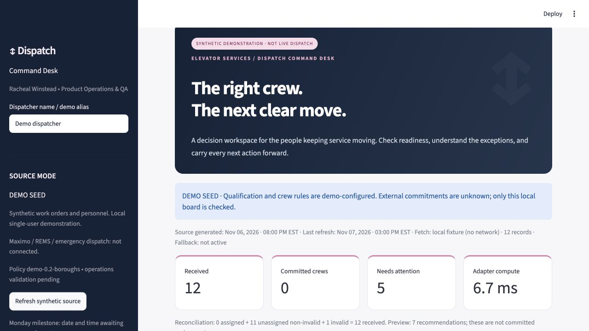

# Elevator Dispatch

NYCHA elevator dispatchers must coordinate Elevator Mechanics and Elevator Mechanic Helpers, record elevator performance and crew activity, and keep work-order information accurate across nights, weekends, and shift changes. When that information is incomplete or scattered, dispatchers can lose time, duplicate effort, or hand off unfinished work without a clear next step.

Elevator Dispatch is a dispatcher-assistance tool that brings work orders, crew-readiness checks, assignment review, progress tracking, and shift handover into one clear workflow. The dispatcher remains responsible for reviewing and confirming every assignment.

*Built by Racheal Winstead and Deshawn Jeter.*

## Product Preview



*The dispatcher command desk uses synthetic demonstration data and does not connect to live NYCHA systems.*

## What It Does

Elevator Dispatch gives dispatchers one place to see urgent work, match it to qualified crews, and hand off unfinished jobs without losing context. The dispatcher always reviews and confirms assignments.

## Key Features

- **Work Queue:** Organizes service requests by status, priority, borough, and intake readiness so dispatchers can quickly see which work order needs action next.
- **Crew Readiness:** Checks attendance, role, qualifications, shift availability, and borough/depot authorization, and explains why each worker qualifies or is excluded.
- **Dispatch Plan:** Recommends a complete mechanic-and-helper crew and work window, then requires dispatcher review and confirmation before anything is assigned.
- **Progress & Exceptions:** Records status, blockers, owner, and next action in an append-only activity history so earlier information is not silently overwritten.
- **Shift Handover & Messaging:** Carries unresolved work into the next shift and simulates assignment messages and crew acknowledgements without losing work-order context.

## Tech Stack

- **Python 3.11+:** Application logic, data models, validation, and scheduling integration
- **Streamlit 1.61:** Interactive dispatcher console, navigation, and interface testing
- **Pandas 3.0:** Work-order, roster, and scheduling-engine data transformation
- **SQLite:** Local assignments, progress updates, audit history, and shift-handover records
- **Custom Python data adapter:** Translates roster and work-order data for Deshawn's pinned scheduling engine
- **Python `unittest` and Streamlit AppTest:** Workflow, adapter, safety-regression, and interface testing
- **CSV export:** Assignment, exception, open-work, and handover reports

> **Scope note:** This prototype uses synthetic sample data. It does not connect to an external API, live NYCHA/Maximo data, or an AI/LLM service.

## Racheal’s reviewed local implementation

This checkout is on `codex/racheal`, tracking `origin/codex/racheal` in
[Racheal-Winstead/Elevator-Dispatch](https://github.com/Racheal-Winstead/Elevator-Dispatch).
The application lives in `elevator-dispatcher/`, matching the directory layout on Deshawn’s branch.

The console uses synthetic work orders and personnel, a data adapter for Deshawn’s pinned engine,
review-before-commit crew assignment, and local SQLite-backed activity history. It does not connect
to Maximo, REMS, live staffing or emergency dispatch. Demo eligibility and crew policies are not
verified NYCHA operational rules. Shared storage adoption and merging into `developer` are pending.

```sh
cd elevator-dispatcher
python3 -m streamlit run app.py --server.address 127.0.0.1 --server.port 8502
python3 -m unittest discover -s tests -v
```

Dependencies and their tested versions are in `elevator-dispatcher/requirements.txt`.
The checked-in upstream engine source and its exact commit/checksums are documented in
`elevator-dispatcher/integrations/vendor/SOURCE.json`.

- [Application setup and scope](elevator-dispatcher/README.md)
- [Implemented changes and proposed commit descriptions](elevator-dispatcher/docs/IMPLEMENTATION_UPDATE_2026-11-08.md)
- [Data adapter contract](elevator-dispatcher/docs/INTEGRATION_CONTRACT.md)
- [Learning guide](elevator-dispatcher/docs/LEARNING_GUIDE.md)
- [2½-minute demo recording script](elevator-dispatcher/docs/PANEL_DEMO.md)
- [2½-minute presentation content notes](elevator-dispatcher/docs/PRESENTATION_NOTES.md)

## Checkout and history notes

The files were copied byte-for-byte from the reviewed local project into this dedicated repository;
the original demonstration folder remains available. The branch retains the existing remote history
starting at `7271c01`. Placement made no commit or push and did not merge another branch.

Some application documents describe the earlier chat-folder setup and its inherited home-directory
Git root. Those are historical notes: this dedicated checkout now has its own `.git` directory and
verified GitHub remote. Run Git commands here, not from the original chat folder.

Runtime databases, local secrets, Python caches and virtual environments are excluded. The original
SQLite database and scratch review downloads were not copied into this checkout.

## Job-description basis

The project is grounded in the expired NYCHA **Elevator Dispatcher** posting, **Job ID 647208**, supplied by Racheal on November 9, 2026. The [preserved source text](elevator-dispatcher/docs/sources/NYCHA_ELEVATOR_DISPATCHER_647208.txt) includes all six duties and posting metadata. The original URL has not been supplied, and the text has not been independently verified online.

The strongest current demonstration is crew coordination, data validation and recording selected crew/work activities. [Duty-by-duty mapping and role context](elevator-dispatcher/docs/JD_ALIGNMENT.md) distinguish working features from future Maximo entry/report integration and out-of-scope equipment maintenance.

## Assumption log

These are project assumptions, not NYCHA policies or findings from a dispatcher interview. The JD does not validate the riskier operational rules. They are used only in the synthetic demonstration pending review.

### Crew composition

**Gap:** The JD names mechanics and helpers but does not prescribe crew sizes by work type.

**Assumption:** Demo corrective work needs one mechanic plus one helper; inspection uses one mechanic.

**Why:** This demonstrates coordination of the named roles and complete-crew validation without assuming a universal legal pairing rule.

**Check:** Ask an authorized operations/safety stakeholder to approve role requirements by work type before any real use.

### Attendance, qualifications and geographic authorization

**Gap:** The JD provides no authoritative attendance feed, technician qualification matrix or depot/sector rules.

**Assumption:** Fictional roster configuration supplies these fields; UNKNOWN attendance and UNVERIFIED qualifications are unavailable.

**Why:** A deterministic demonstration needs explicit eligibility facts; the dispatcher’s own entry-level requirements do not establish mechanic/helper eligibility.

**Check:** Identify approved staffing and qualification sources and validate geographic/depot authority with operations.

### Capacity and shifts

**Gap:** Nights/weekends are explicit, but shift hours, staffing numbers and existing commitments are unspecified.

**Assumption:** Ten synthetic people and four bounded daytime windows demonstrate one shift; only local commitments are checked.

**Why:** A bounded scenario makes capacity and collision behavior explainable. It is not complete night/weekend coverage.

**Check:** Confirm actual shift patterns and carry-over/external booking inputs; test additional shifts before claiming support.

### Maximo data and reports

**Gap:** The JD requires Maximo entry and reports but supplies no API, object schema, credentials or authorization.

**Assumption:** Local structured records and CSV exports demonstrate preparation and handover; no Maximo read/write or official reports are claimed.

**Why:** This supports review of information without inventing access or silently treating local status as official system status.

**Check:** Obtain approved interface specifications, access and reconciliation requirements from NYCHA IT/operations.

### Hazard and priority decisions

**Gap:** The JD does not define priority taxonomy, emergency classification, escalation recipients or timer thresholds.

**Assumption:** Explicit synthetic flags and configured ordering support review; keywords alone never confirm an emergency. No official 90-minute timer is enforced.

**Why:** This makes human decision points visible without deriving a real safety policy from an incomplete source.

**Check:** Validate current procedures with the responsible operations/safety authority before operationalizing them.

### Activity history and handover

**Gap:** The JD calls for records but does not specify a handover template, status lifecycle or retention rules.

**Assumption:** Local SQLite history and owner/status/last-update/blocker/next-action fields support a single-user demo. Shared adoption with Deshawn remains pending.

**Why:** Persistent records let the next shift understand recorded work; RESTORED and CLOSED remain distinct.

**Check:** Review actual handover, retention, security and closure procedures with dispatchers and IT.

### Working with interruptions

**Gap:** Simultaneous coordination is a preferred skill, but no user research or current workflow observations are supplied.

**Assumption:** Clear ticket context, plain-language exclusions and explicit confirmation help a dispatcher resume work after interruptions.

**Why:** This is a reversible design inference from multitasking and data-accuracy duties. It is not evidence of user satisfaction or time saved.

**Check:** Conduct a short task-based walkthrough with a dispatcher; observe errors and comprehension before making usability claims.
