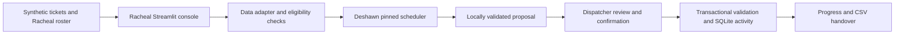

# Presentation notes — 2½ minutes

These are content and speaker notes for a future slide deck, not an exported presentation file. Pair them with the [2½-minute working-demo script](PANEL_DEMO.md). The supplied coach material specifies five minutes combined, submitted via Google Form by Wednesday, November 11 at noon. Verify the form link and any updated instructions before submission.

## Slide 1 — The person and the job (0:00–0:30)

**Show:** Elevator Dispatcher · NYCHA · Job ID 647208 · expired source posting. Three phrases: coordinate teams; record work; keep data accurate.

**Say:** “Our source is the NYCHA Elevator Dispatcher JD. It names team dispatch, activity recording, Maximo entry and reports, data accuracy, and terminal maintenance. We focused on a demonstrable slice: helping a dispatcher coordinate crews and maintain clear, accurate work records.”

**Source note:** Text supplied by Racheal on November 9. Original URL not supplied; no claim of independent webpage verification.

## Slide 2 — The workflow problem and our focus (0:30–1:00)

**Show:** Review work → check crew → confirm decision → record progress → hand over.

**Say:** “The JD explicitly values coordinating simultaneous tasks and communication, including nights and weekends. We inferred that visible context, clear exclusion reasons and next actions could help someone resume work after an interruption. That is a design hypothesis, not a result from a dispatcher interview.”

**Boundary:** The current four-window demo does not establish complete night/weekend scheduling coverage.

## Slide 3 — Architecture and ownership (1:00–1:30)

**Show:** The architecture diagram below, with Racheal and Deshawn ownership labels.

**Say:** “I own the console, demo roster and QA. The adapter maps our fields and roles to Deshawn’s pinned scheduler, then converts its output into a proposal. Local checks run before and after scheduling and again at commitment. SQLite is our local persistence layer; team adoption of shared storage is still pending.”

The pinned upstream engine remains unchanged and attributed. The adapter does not execute Deshawn’s separate app, source-switch or messaging flows.

## Slide 4 — What works and what we checked (1:30–2:00)

**Show:** Complete crews; conflict prevention; explicit review; persistent history. “46 automated tests passed locally.”

**Say:** “The working slice includes review holds, roster readiness, complete-crew recommendations, confirmation, progress and handover exports. Our tests cover invalid attendance and qualifications, overlapping windows, rollback, stale previews, persistence and UI interaction. We corrected timezone comparison and status-versus-booking defects.”

**Evidence note:** Local tests demonstrate software behavior, not NYCHA operational approval or service improvements.

## Slide 5 — Honest coverage and next steps (2:00–2:30)

**Show:** Now: coordination + local work records + data checks. Next: partner review + user validation + approved Maximo interface.

**Say:** “The JD requires Maximo entry and official reports. We currently provide structured local records and CSV exports, not Maximo access. Authoritative performance reporting and equipment maintenance are outside this slice. Next are partner review, validation with someone in the role, and approved operational and system interfaces.”

## Still needed for submission

Build the actual slide file from these notes, record the working demo, rehearse the full five minutes with Deshawn, verify the submission form and upload both deliverables. The README already contains the four-part assumption log; the original JD is no longer a missing artifact. The original posting URL remains unavailable.
